<div align="center">

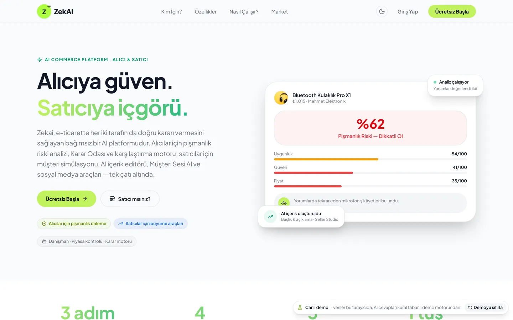

# ZekAI

### Trust for the buyer. Insight for the seller.

An AI decision platform for both sides of e-commerce, and the small marketplace it connects to.<br>
**HackAthon'26 · BTK Akademi × Google × Girişimcilik Vakfı**

[**Live demo**](https://zekai-platformm.vercel.app/login) ·
[Akıllı Market](https://akilli-markett.vercel.app/login) ·
[Documentation](docs/en/README.md) ·
[Run it with one command](#run-it-with-one-command) ·
[Türkçe](README.md)


</div>

---

My teammate Ayşe Mandıralı and I built ZekAI in six days for HackAthon'26; I was the captain of our two-person
team. It helps the buyer with "should I buy this product?" and the seller with "why isn't my product selling?". A
buyer pastes a product link and describes their need in their own words; ZekAI weighs the product, the reviews and
the price together and gives a clear verdict. A seller has five different customer profiles walk through a product
page, then improves its content, images, bundles and review replies with AI.

To show a real integration, we also wrote a second product: **Akıllı Market**, a small marketplace with its own
database and seller panel. ZekAI connects to it from the outside, with the seller's API key. This repository is the
system we wrote that week. Afterwards I added a live demo that runs without a backend, cleaned up the repository and
wrote documentation in which every claim is checked against the code.

The interface is in Turkish; the [demo tour](docs/en/02-demo-tour.md) translates every screen and button.

## How to review it

| How much time do you have? | My suggestion |
|---|---|
| 1 minute | Open the [live demo](https://zekai-platformm.vercel.app/login) and click **Alıcı olarak gir** (buyer) or **Satıcı olarak gir** (seller). No setup or account needed. |
| 5 minutes | Follow the [demo tour](docs/en/02-demo-tour.md) through the buyer, seller and marketplace flows. |
| 15 minutes | Read the decisions behind the code in [Architecture](docs/en/03-architecture.md), [AI pipeline](docs/en/07-ai-pipeline.md) and [Problems I solved](docs/en/11-problems-i-solved.md). |
| You want to see the real system | Run PostgreSQL, both APIs and the AI service in Docker [with one command](#run-it-with-one-command). |

The live demo runs in the browser so that it can stay up without server costs, and it uses the same contract as
the real APIs. I explain why in [Deployment strategy](docs/en/09-deployment-strategy.md).

## Story: a six-day hackathon, then a showcase

ZekAI was written between 14 and 19 May 2026 for HackAthon'26, whose theme was AI for e-commerce. When the
competition ended, the frontends were on Vercel and the three services and the database were on Render's free
tier. Six months later the services had gone to sleep and the database had expired; anyone looking at the project
could not get past the login screen. When I put the project in my portfolio, I brought it back to life. The full
story: [docs/en/01-story.md](docs/en/01-story.md).

| | End of the competition (May 2026) | Today |
|---|---|---|
| **Live demo** | The frontends depend on services on Render; once they sleep, nobody can sign in | A demo that runs in the browser; every role with one click |
| **Landing copy** | "8 AI agents" | The real pipeline: advisor → market check if needed → decision engine |
| **Simulation preview** | A fixed 4.7 rating and 128 reviews on every product | The product's own rating, review count, shipping and warranty |
| **Login page** | Google/Apple buttons that did nothing | A one-click sign-in card for each role |
| **Repository** | Template files, `tsbuildinfo`, unused types | Clean; only working code |
| **Documents** | The competition submission; some claims out of date | 12 documents checked against the code, in Turkish and English |

## What you can do

<table>
  <tr>
    <td width="50%">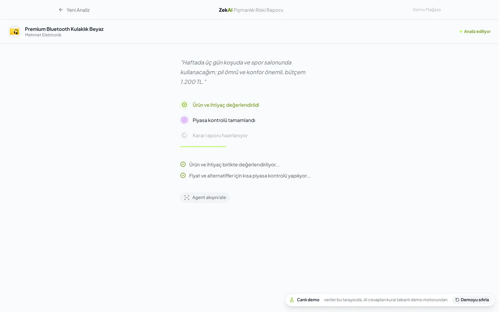</td>
    <td width="50%">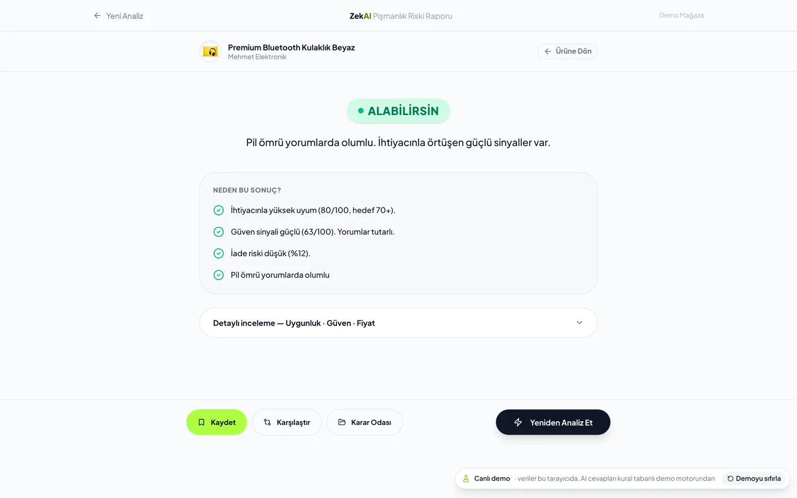</td>
  </tr>
  <tr>
    <td><b>Live analysis flow.</b> The advisor, a market check if needed, then the decision. Each step completes
    only when its own result arrives; there is no fake progress bar.</td>
    <td><b>A rule engine makes the call.</b> Go ahead, proceed with care or look for an alternative. The "why
    this result?" list is the set of rules that produced the verdict.</td>
  </tr>
  <tr>
    <td>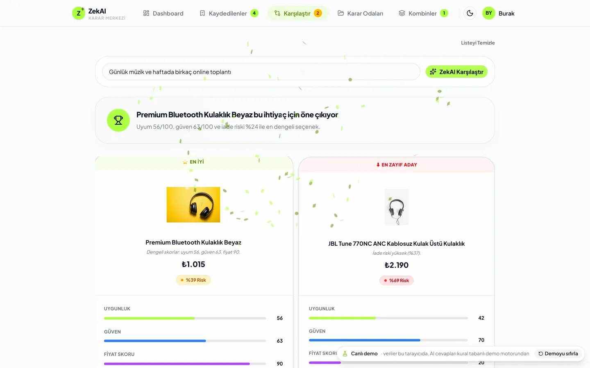</td>
    <td>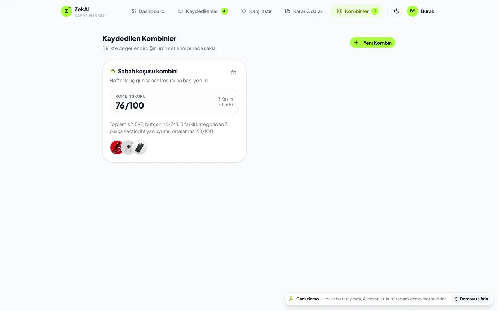</td>
  </tr>
  <tr>
    <td><b>Comparison.</b> A winner among saved analyses for the buyer's need, with a one-sentence reason for
    each product.</td>
    <td><b>Kombins.</b> Products bought together, judged on need and budget fit, with a kombin score and a
    purchase order.</td>
  </tr>
  <tr>
    <td>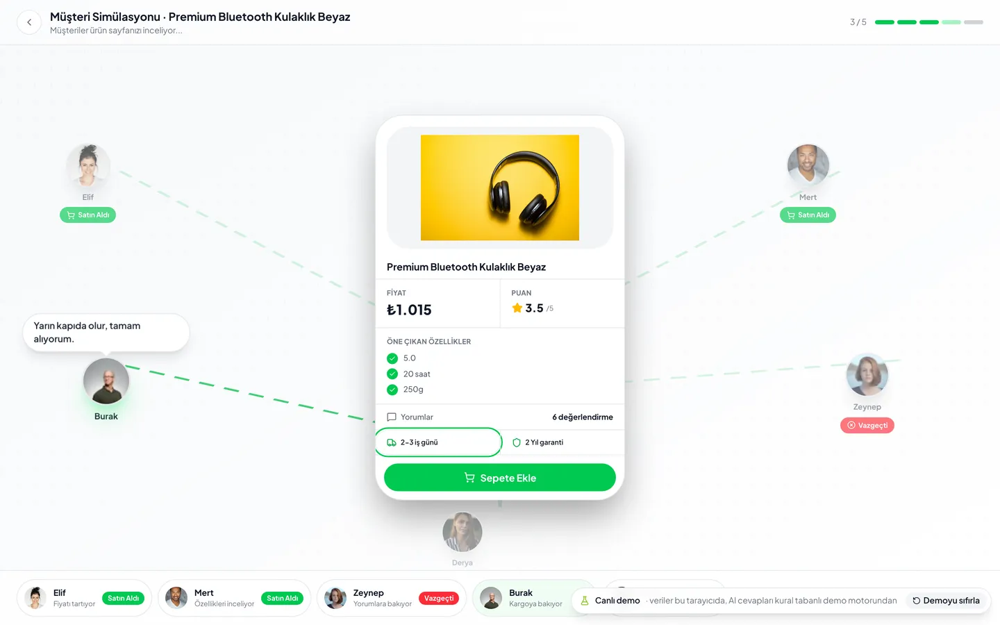</td>
    <td>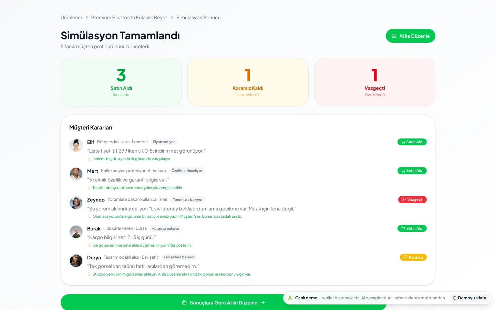</td>
  </tr>
  <tr>
    <td><b>Customer simulation.</b> Five customer profiles each look at the part of the page they care about:
    price, specs, reviews, shipping or photos.</td>
    <td><b>Simulation result.</b> Who bought, who hesitated, who walked away. Their reasons can feed straight into
    the content editor.</td>
  </tr>
  <tr>
    <td>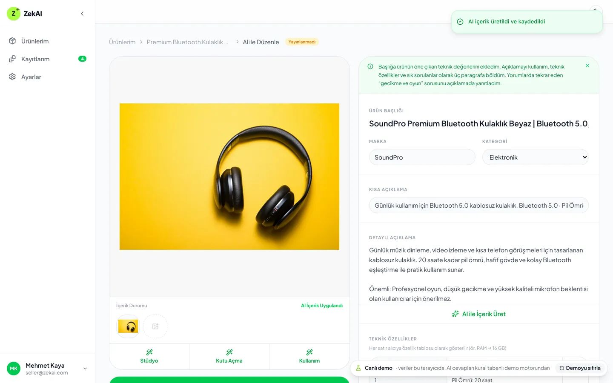</td>
    <td>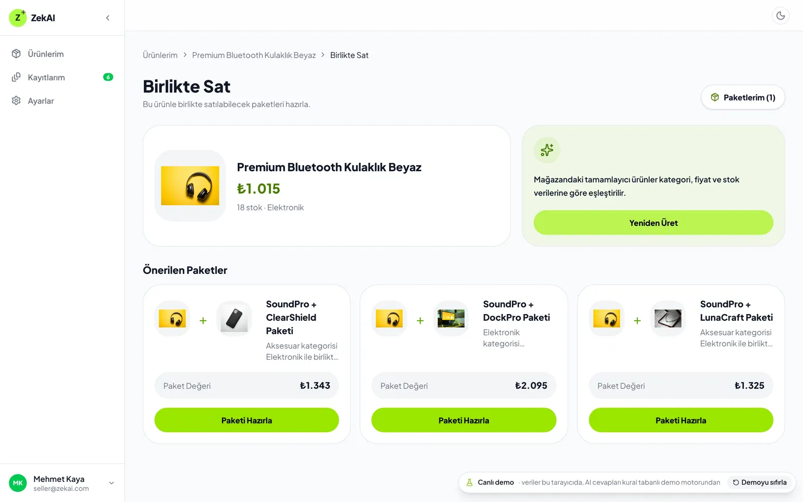</td>
  </tr>
  <tr>
    <td><b>Content with AI.</b> Title, descriptions, feature bullets and studio, unboxing and in-use images.
    Every output is saved as a draft and reused.</td>
    <td><b>Sell together.</b> Complementary product suggestions and bundles whose discount is split between the
    two products in proportion to their prices.</td>
  </tr>
  <tr>
    <td>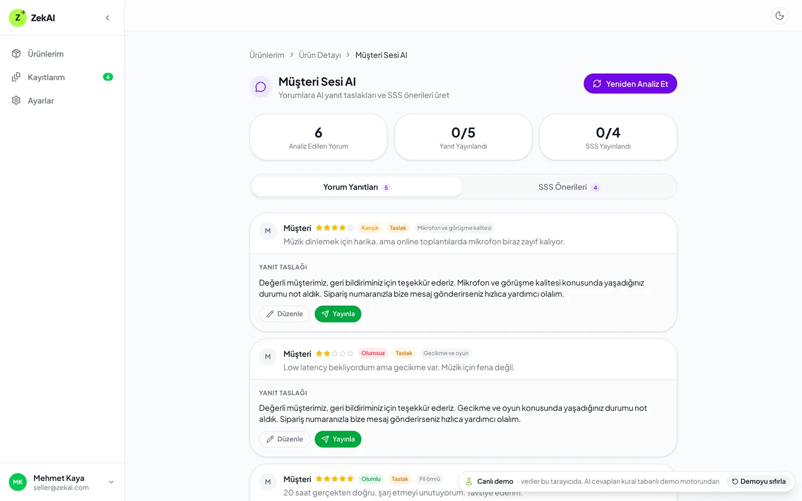</td>
    <td>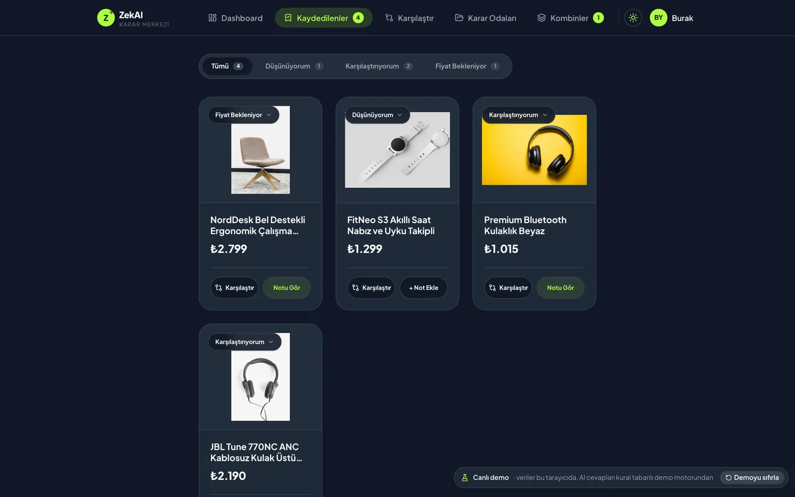</td>
  </tr>
  <tr>
    <td><b>Customer Voice.</b> A draft reply for every review and FAQs drawn from the reviews; reviews with
    complaints are flagged as needing a reply.</td>
    <td><b>Light and dark themes.</b> Saved analyses, each with a status and a note.</td>
  </tr>
  <tr>
    <td>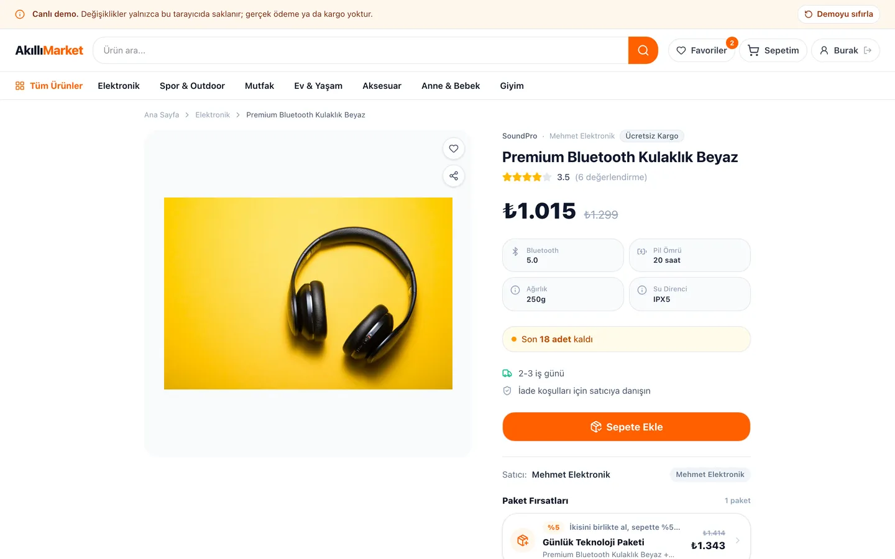</td>
    <td>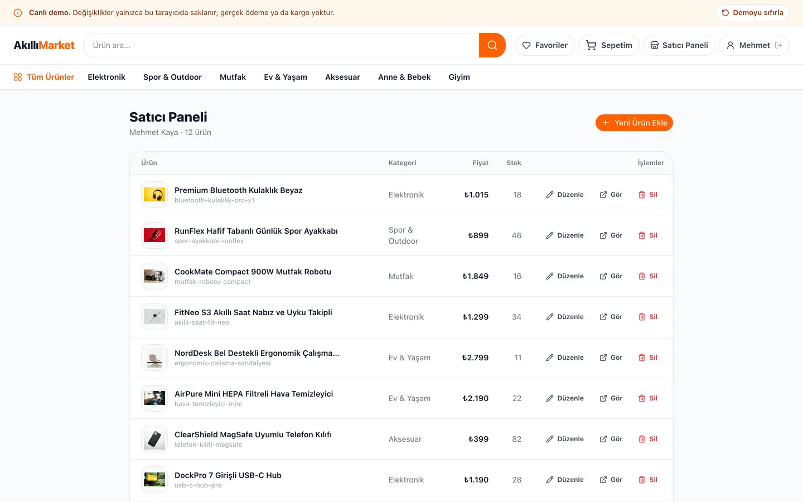</td>
  </tr>
  <tr>
    <td><b>Akıllı Market.</b> The marketplace ZekAI connects to: product pages, bundle deals, cart and orders.</td>
    <td><b>Seller panel.</b> The store's products: add, edit, price and stock.</td>
  </tr>
  <tr>
    <td>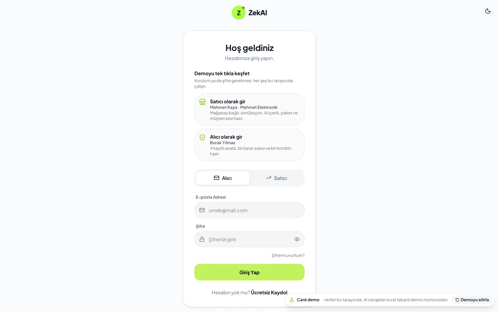</td>
    <td>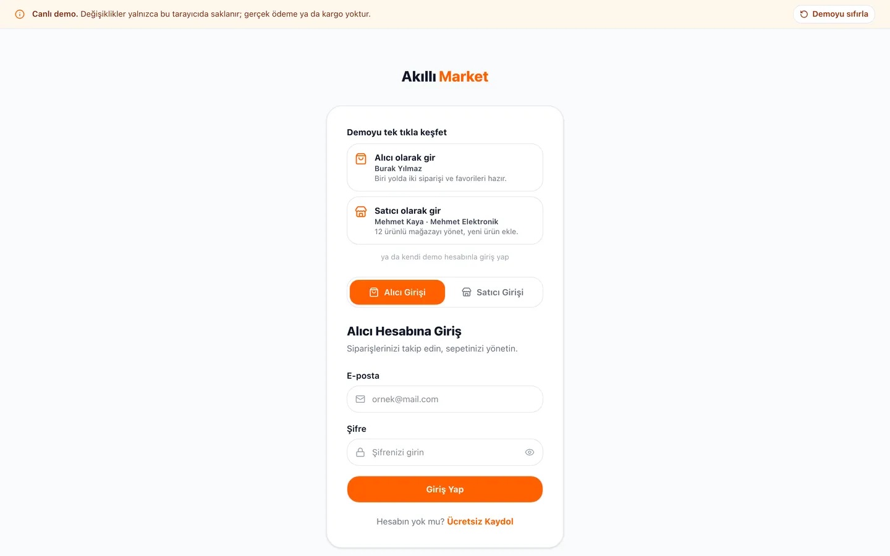</td>
  </tr>
  <tr>
    <td><b>One-click demo.</b> A password-free sign-in card for each role. Data stays in your own browser;
    <b>Demoyu sıfırla</b> (reset the demo) starts over.</td>
    <td><b>Two sites, four roles.</b> Akıllı Market has buyer and seller cards too.</td>
  </tr>
</table>

<p align="center">
  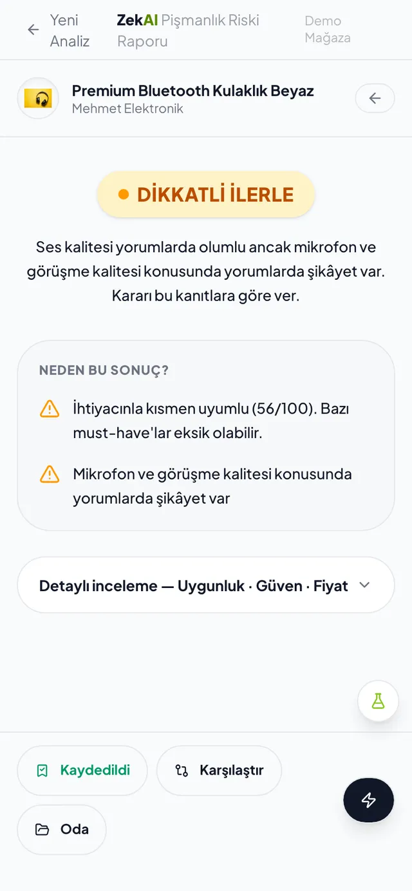&nbsp;
  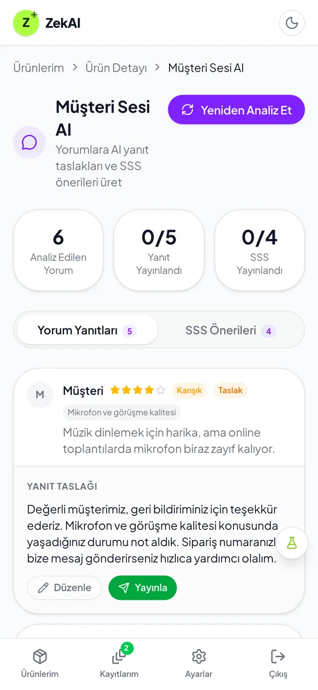&nbsp;
  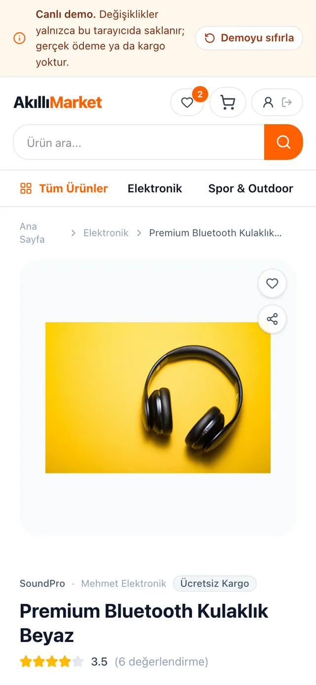
</p>

## Engineering highlights

My favourite interview topics; each one is backed by code in this repository:

1. **Two products, a real integration.** ZekAI connects to the marketplace's API, not its database, on the
   seller's behalf with an API key issued by the marketplace. → [Architecture](docs/en/03-architecture.md)
2. **Two kinds of identity in one header.** A policy scheme in `commerce-api` looks at the token's shape and routes
   the request to the JWT or the API key handler; controllers never see the difference. → [Security](docs/en/06-security.md)
3. **The model scores, the code decides.** Gemini produces four scores and evidence-backed warnings; the purchase
   verdict comes from a pure function with explicit thresholds. → [AI pipeline](docs/en/07-ai-pipeline.md)
4. **From seven calls to one.** I cut a seven-agent Google ADK pipeline down to a single structured call plus a
   market check that runs only when needed; the kombin analysis went from five calls to one.
5. **The cache key is everything that changes the result.** The analysis key is derived from the user, the product,
   the normalised need and the product's fingerprint; when the product changes, so does the key, with no
   invalidation code.
6. **An honest fallback when the quota runs out.** Seller tools show a flagged sample answer with a yellow
   warning; buyer analysis ends with a clear error instead of a made-up verdict.
7. **Long answers, live stream.** The AI service sends a Server-Sent Event at every step; `zekai-api` relays the
   stream line by line while catching the final report for the cache. → [Frontend and design](docs/en/08-frontend-and-design.md)
8. **Bundle discounts split to the cent.** The discount is shared between two products in proportion to their
   prices, and every order line carries its own discount. → [Domain rules](docs/en/05-domain-rules.md)
9. **Rules enforced in the database too.** A partial unique index that ignores archived bundles, one cart per
   buyer, one reply per review; money is `numeric` everywhere. → [Database](docs/en/04-database.md)
10. **The server sets the price.** Orders take prices from the database, not the client; a product's rating is
    always calculated from its stored reviews.
11. **A seller's change reaches the storefront instantly.** After each change `commerce-api` calls Akıllı
    Market's revalidation endpoint, and Next.js regenerates only the affected pages.
12. **One frontend, two deployments.** Every network call goes through one `transport` function: on Vercel, a demo
    that fulfils the same contract in the browser; in Docker, the real APIs. → [Deployment strategy](docs/en/09-deployment-strategy.md)

I did not hide the gaps either: there are no tests, some service files are very large and some secrets are plain
text. The full list and the roadmap: [Interview questions and limits](docs/en/12-faq-and-limits.md).

## Architecture

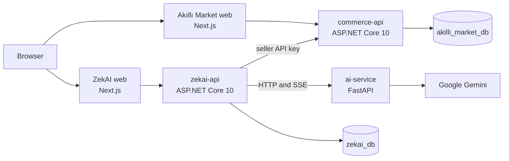

The system is two products and three services. Each product owns its own database; ZekAI reaches the marketplace's
data only through its API. The browser never sees the AI service, and the Gemini key lives only in that service's
environment. Both .NET APIs are split into `Api`, `Application`, `Domain` and `Infrastructure` projects; in the AI
service, the decision and scoring code sits in files separate from the model calls. Details:
[docs/en/03-architecture.md](docs/en/03-architecture.md).

## Technologies

| Layer | Choices |
|---|---|
| Frontends | Next.js 16 (App Router), React 19, TypeScript (strict), Tailwind CSS 4, shadcn/ui (Radix), Framer Motion |
| Frontend state and visuals | Zustand 5, TanStack Query 5, React Flow 12, three.js and React Three Fiber |
| APIs | .NET 10, ASP.NET Core, Entity Framework Core with Npgsql, JWT (HS256), BCrypt, Swagger |
| AI | Python 3.12, FastAPI, Google GenAI SDK, Google ADK, Pydantic; `gemini-2.5-flash-lite` as the default model |
| Data | PostgreSQL 16 (`pgvector/pgvector:pg16` image), two separate databases |
| Running it | Docker Compose (database, both APIs and the AI service), Vercel (frontends and the live demo) |

## Run it with one command

Docker is enough for the backend; the AI features need a [Google AI Studio](https://aistudio.google.com) key.
Without a key the system still starts, and only the AI endpoints answer `503`.

```bash
git clone https://github.com/mrfiratatalay/btk-zekai.git
cd btk-zekai
cp .env.example .env          # fill in GOOGLE_API_KEY
docker compose up --build     # PostgreSQL, commerce-api, zekai-api, ai-service
```

The frontends are not part of Docker Compose; start them in two terminals:

```bash
cd apps/akilli-market-web && cp .env.example .env.local && npm install && npm run dev
cd apps/zekai-platform-web && cp .env.example .env.local && npm install && npm run dev -- --port 3001
```

| Address | What's there |
|---|---|
| http://localhost:3000 | Akıllı Market |
| http://localhost:3001 | ZekAI |
| http://localhost:5001/swagger, http://localhost:5002/swagger | Swagger UI for both APIs |

Accounts, environment variables and the API by example: [docs/en/10-running-and-api.md](docs/en/10-running-and-api.md).
On Windows, the scripts in [`scripts/`](scripts) do the same job.

## Documentation

I explain the project in my own words, in detail, in [`docs/en/`](docs/en/README.md):

| | |
|---|---|
| [01 · Story](docs/en/01-story.md) | The HackAthon'26 week, team and roles, what I did after the competition |
| [02 · Demo tour](docs/en/02-demo-tour.md) | A five-minute, non-technical tour with every screen translated |
| [03 · Architecture](docs/en/03-architecture.md) | Two products, three services, layers and the journey of a request |
| [04 · Database](docs/en/04-database.md) | Two separate databases, the schema, rules enforced in the database |
| [05 · Domain rules](docs/en/05-domain-rules.md) | Bundle discounts, the decision engine, price fairness, return risk, kombins |
| [06 · Security](docs/en/06-security.md) | Two separate JWTs, the seller API key, the error format, known gaps |
| [07 · AI pipeline](docs/en/07-ai-pipeline.md) | Using Gemini with cost control: one call, a deterministic verdict, caching |
| [08 · Frontend and design](docs/en/08-frontend-and-design.md) | Two Next.js apps, reading SSE, design language, mobile |
| [09 · Deployment strategy](docs/en/09-deployment-strategy.md) | An always-on live demo without server costs |
| [10 · Running it and the API](docs/en/10-running-and-api.md) | Setup, environment variables, the API by example |
| [11 · Problems I solved](docs/en/11-problems-i-solved.md) | Problem, solution, reasoning: twelve short stories |
| [12 · Interview questions and limits](docs/en/12-faq-and-limits.md) | Likely interview questions, known limits, the roadmap |

## Project structure

```text
apps/akilli-market-web/   Marketplace frontend (Next.js) and its in-browser demo layer
apps/zekai-platform-web/  ZekAI frontend: buyer decision centre and Seller Studio (Next.js), demo layer
services/commerce-api/    Marketplace API (ASP.NET Core): Api / Application / Domain / Infrastructure
services/zekai-api/       ZekAI API (ASP.NET Core): store integration, AI proxy, caching
services/ai-service/      AI service on Gemini (FastAPI): buyer/ and seller/
infra/postgres/           init.sql that creates both databases
scripts/                  Start scripts for Windows
docs/                     Detailed documentation (Turkish, English in docs/en) and screenshots
docker-compose.yml        PostgreSQL, both APIs and the AI service
```

## Team

We built ZekAI for HackAthon'26 as a two-person team:

- **Fırat Atalay** · team captain · [GitHub](https://github.com/mrfiratatalay)
- **Ayşe Mandıralı** · teammate

Who wrote what is on the [Story](docs/en/01-story.md#who-did-what) page. I wrote a significant part of the code
together with AI (Claude Code), under rules I set myself.

Thanks to BTK Akademi, Google and Girişimcilik Vakfı for HackAthon'26. This is an independent portfolio project.
Akıllı Market is a fictional marketplace; the names Google, Gemini, Trendyol, Hepsiburada and N11 belong to their
owners and are mentioned only for reference. Sample product photos come from Unsplash.
