<div align="center">

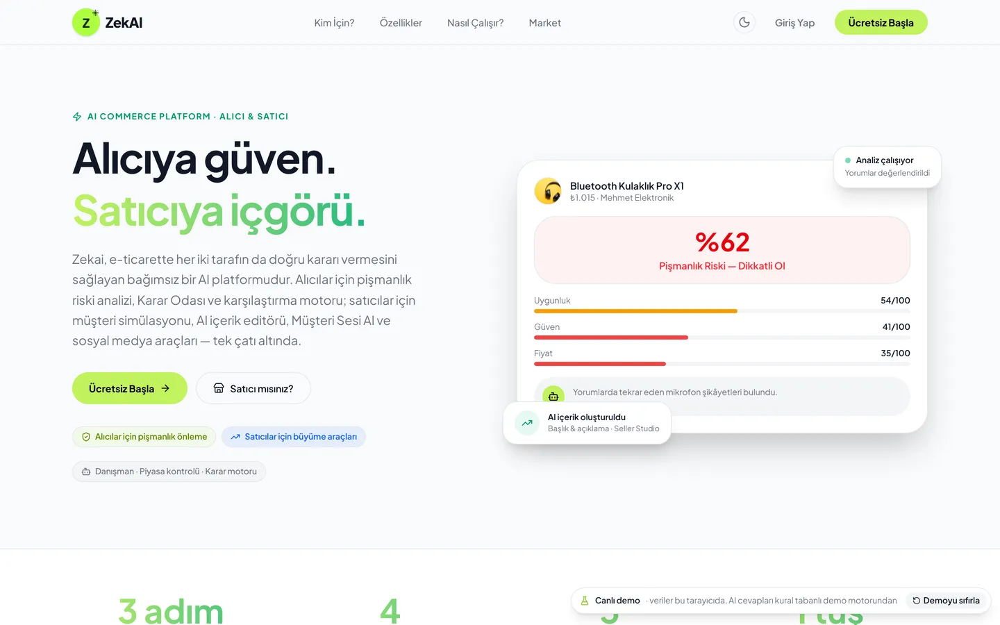

# ZekAI

### Alıcıya güven. Satıcıya içgörü.

E-ticaretin iki tarafına da yapay zekâyla destek veren bir karar platformu ve ona bağlanan küçük bir pazar yeri.<br>
**HackAthon'26 · BTK Akademi × Google × Girişimcilik Vakfı**

[**Canlı demo**](https://zekai-platformm.vercel.app/login) ·
[Akıllı Market](https://akilli-markett.vercel.app/login) ·
[Dokümanlar](docs/README.md) ·
[Tek komutla çalıştır](#tek-komutla-çalıştır) ·
[English](README.en.md)


</div>

---

ZekAI'ı HackAthon'26'da takım arkadaşım Ayşe Mandıralı ile altı günde geliştirdik; iki kişilik takımımızın
kaptanıydım. Alıcıya "bu ürünü alayım mı?", satıcıya "ürünüm neden satmıyor?" sorusunda yardım ediyor. Alıcı bir
ürün linkini yapıştırıp ihtiyacını kendi cümleleriyle yazıyor; ZekAI ürünü, yorumları ve fiyatı birlikte
değerlendirip net bir karar veriyor. Satıcı ise ürün sayfasını beş farklı müşteri profiline gezdiriyor; içeriğini,
görsellerini, paketlerini ve yorum cevaplarını yapay zekâyla iyileştiriyor.

Bir entegrasyonu gösterebilmek için ikinci bir ürün de yazdık: kendi veritabanı ve satıcı paneli olan küçük bir
pazar yeri, **Akıllı Market**. ZekAI ona dışarıdan, satıcının API anahtarıyla bağlanıyor. Bu repo o haftanın
sistemi. Üzerine sonradan backend'siz çalışan bir canlı demo kurdum, repoyu temizledim ve her iddiası koddan
doğrulanmış dokümanlar yazdım.

## Nasıl incelersin?

| Ne kadar vaktin var? | Önerim |
|---|---|
| 1 dakika | [Canlı demoyu](https://zekai-platformm.vercel.app/login) aç ve **Alıcı olarak gir** ya da **Satıcı olarak gir** kartına bas. Kurulum ya da hesap gerekmez. |
| 5 dakika | [Demo turu](docs/02-demo-turu.md) ile alıcı, satıcı ve pazar yeri akışlarını sırayla gez. |
| 15 dakika | [Mimari](docs/03-mimari.md), [Yapay zekâ hattı](docs/07-yapay-zeka.md) ve [Çözdüğüm problemler](docs/11-cozdugum-problemler.md) ile kodun arkasındaki kararları oku. |
| Gerçek sistemi görmek istiyorsan | [Tek komutla](#tek-komutla-çalıştır) PostgreSQL'i, iki API'yi ve yapay zekâ servisini Docker'da çalıştır. |

Canlı demo, sunucu masrafı olmadan her zaman açık kalabilsin diye tarayıcıda çalışıyor ve gerçek API'lerle aynı
sözleşmeyi kullanıyor. Nedenini [Yayın stratejisi](docs/09-yayin-stratejisi.md)'nde anlattım.

## Hikâye: altı günlük bir hackathon, sonra vitrin

ZekAI 14-19 Mayıs 2026 arasında, HackAthon'26'nın e-ticaret odaklı yapay zekâ temasıyla yazıldı. Yarışma
bittiğinde arayüzler Vercel'de, üç servis ve veritabanı Render'ın ücretsiz katmanındaydı. Altı ay sonra servisler
uyumuş, veritabanının süresi dolmuştu; projeye bakan biri giriş ekranından öteye geçemiyordu. Projeyi portfolyoma
koyarken onu yeniden ayağa kaldırdım. Hikâyenin tamamı: [docs/01-hikaye.md](docs/01-hikaye.md).

| | Yarışma sonu (Mayıs 2026) | Bugün |
|---|---|---|
| **Canlı demo** | Arayüzler Render'daki servislere bağlı; servisler uyuyunca giriş yok | Tarayıcıda çalışan demo; her rol tek tıkla |
| **Tanıtım metni** | "8 AI ajan" | Gerçek hat: danışman → gerekirse piyasa kontrolü → karar motoru |
| **Simülasyon önizlemesi** | Her üründe sabit 4.7 puan ve 128 yorum | Ürünün kendi puanı, yorum sayısı, kargosu ve garantisi |
| **Giriş sayfası** | Çalışmayan Google/Apple düğmeleri | Her rol için tek tıkla giriş kartı |
| **Repo** | Şablon dosyaları, `tsbuildinfo`, kullanılmayan tipler | Temiz; yalnızca çalışan kod |
| **Dokümanlar** | Yarışma teslimi; bazı iddialar eskimiş | Koddan doğrulanmış 12 doküman, Türkçe ve İngilizce |

## Neler yapabilirsin?

<table>
  <tr>
    <td width="50%">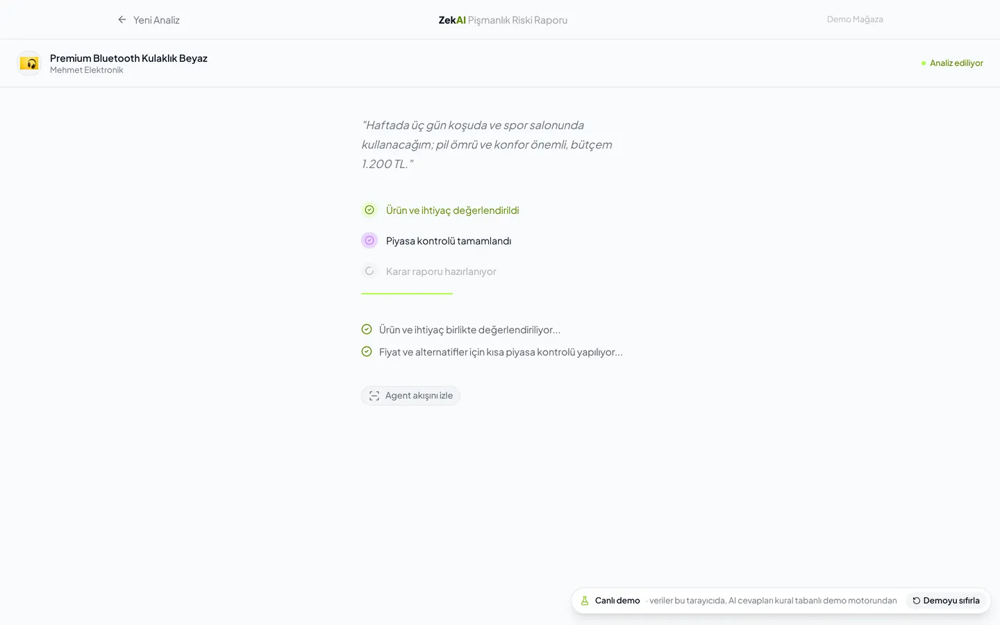</td>
    <td width="50%">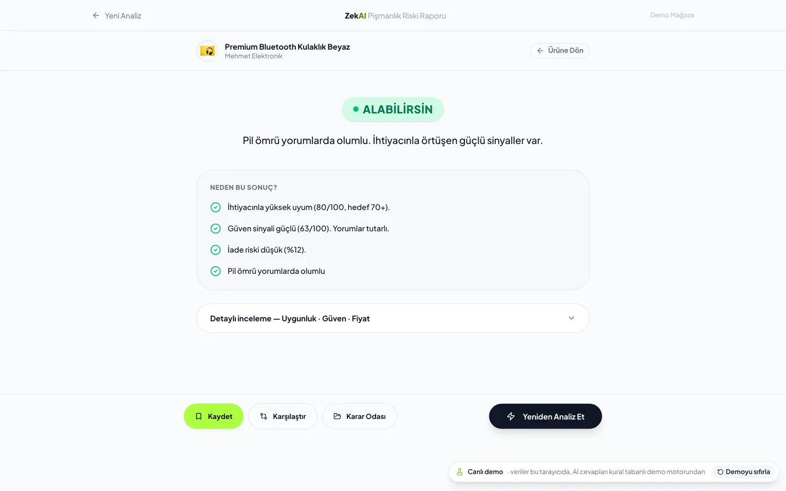</td>
  </tr>
  <tr>
    <td><b>Canlı analiz akışı.</b> Danışman, gerekirse piyasa kontrolü ve karar. Her adım yalnızca kendi sonucu
    geldiğinde tamamlanır; sahte bir ilerleme çubuğu yok.</td>
    <td><b>Kararı kural motoru verir.</b> Alabilirsin, Dikkatli İlerle ya da Alternatife Bak. "Neden bu sonuç?"
    listesi, kararı doğuran kuralların kendisi.</td>
  </tr>
  <tr>
    <td>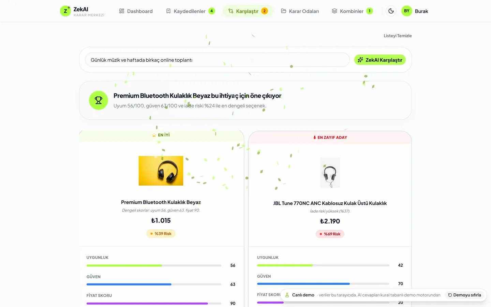</td>
    <td>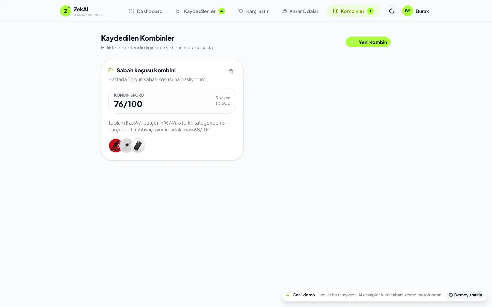</td>
  </tr>
  <tr>
    <td><b>Karşılaştırma.</b> Kaydedilen analizler arasında ihtiyaca göre bir kazanan ve her ürün için tek
    cümlelik gerekçe.</td>
    <td><b>Kombinler.</b> Birlikte alınacak ürünlerin ihtiyaç ve bütçe uyumu, kombin skoru ve satın alma sırası.</td>
  </tr>
  <tr>
    <td>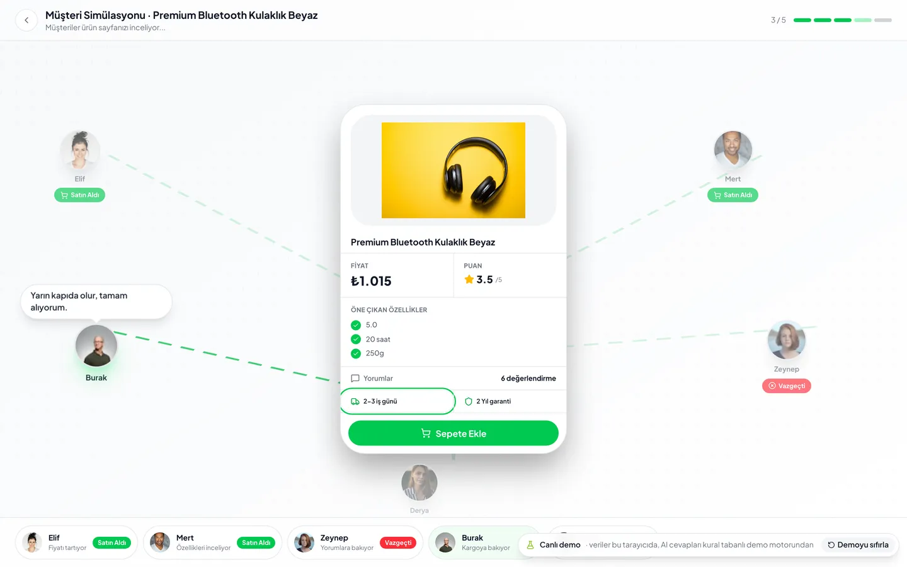</td>
    <td>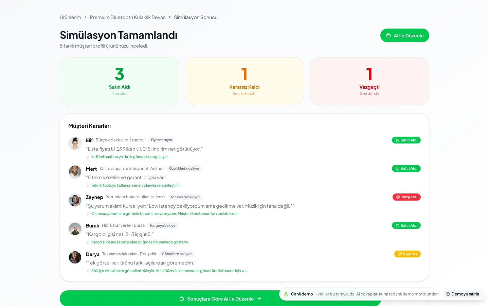</td>
  </tr>
  <tr>
    <td><b>Müşteri simülasyonu.</b> Beş müşteri profili ürün sayfasının kendi önemsediği bölümüne bakar: fiyat,
    özellikler, yorumlar, kargo ya da görseller.</td>
    <td><b>Simülasyon sonucu.</b> Kim aldı, kim kararsız kaldı, kim vazgeçti. Vazgeçme gerekçeleri, içerik
    düzenleme ekranına girdi olarak gidebilir.</td>
  </tr>
  <tr>
    <td>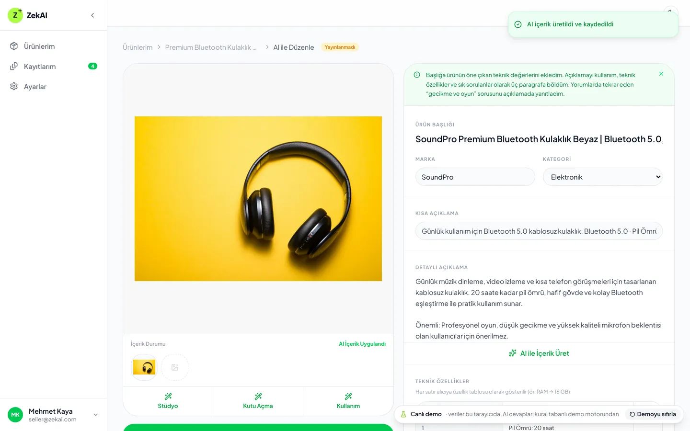</td>
    <td>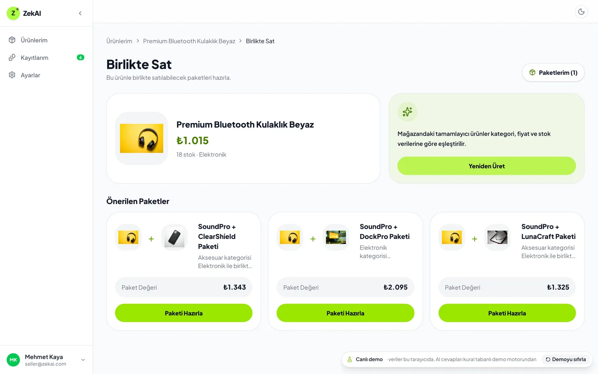</td>
  </tr>
  <tr>
    <td><b>Yapay zekâyla içerik.</b> Başlık, açıklamalar, özellik maddeleri ve stüdyo, kutu açma, kullanım
    görselleri. Her çıktı taslak olarak saklanır ve yeniden kullanılır.</td>
    <td><b>Birlikte sat.</b> Tamamlayıcı ürün önerileri ve indirimin iki ürüne fiyatlarıyla orantılı
    paylaştırıldığı paketler.</td>
  </tr>
  <tr>
    <td>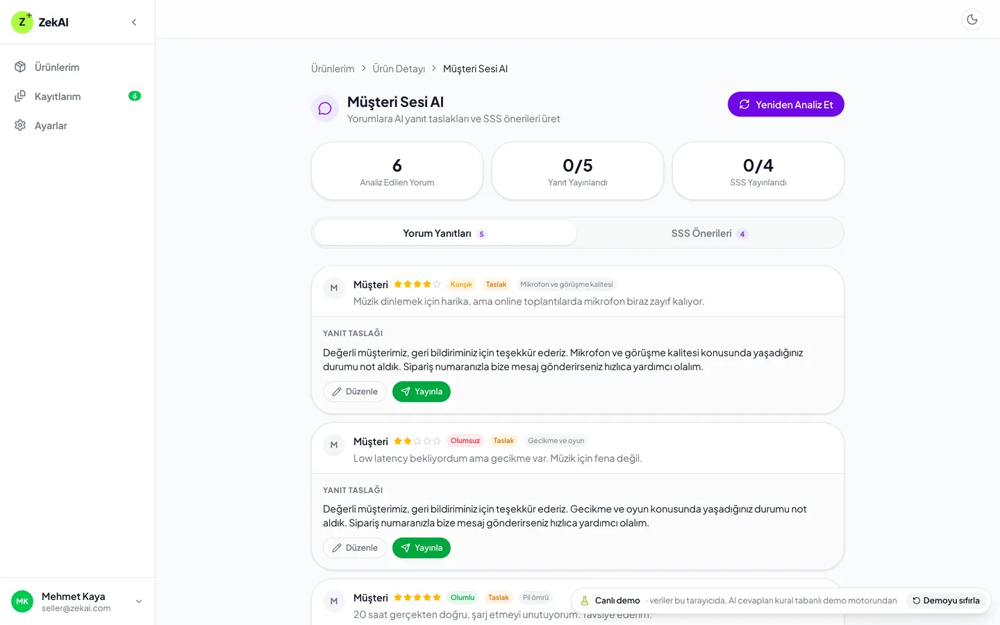</td>
    <td>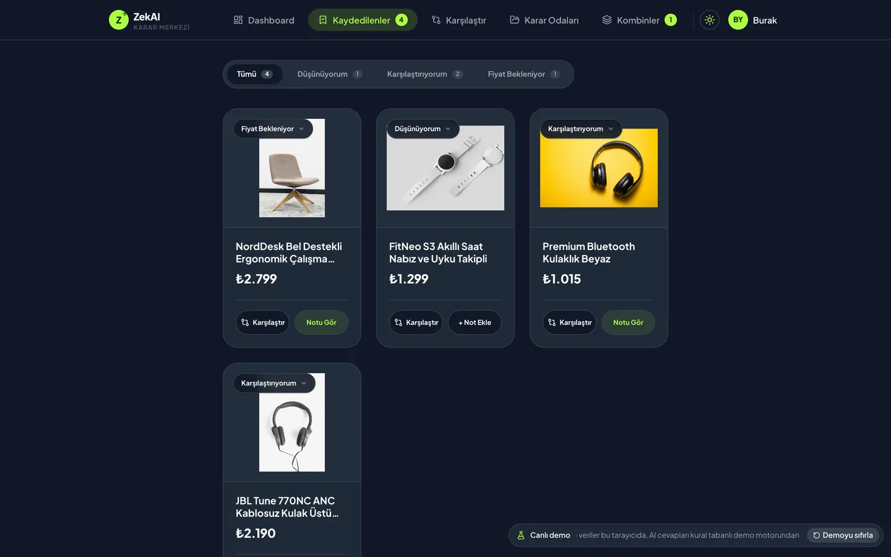</td>
  </tr>
  <tr>
    <td><b>Müşteri Sesi.</b> Her yoruma bir cevap taslağı ve yorumlardan çıkarılmış sık sorulan sorular;
    şikâyet içeren yorumlar "cevap gerekli" diye işaretlenir.</td>
    <td><b>Açık ve koyu tema.</b> Kaydedilen analizler; her birinde durum (Düşünüyorum, Karşılaştırıyorum, Fiyat
    Bekleniyor) ve not.</td>
  </tr>
  <tr>
    <td>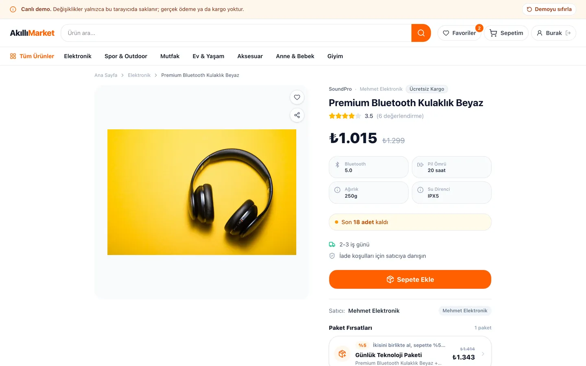</td>
    <td>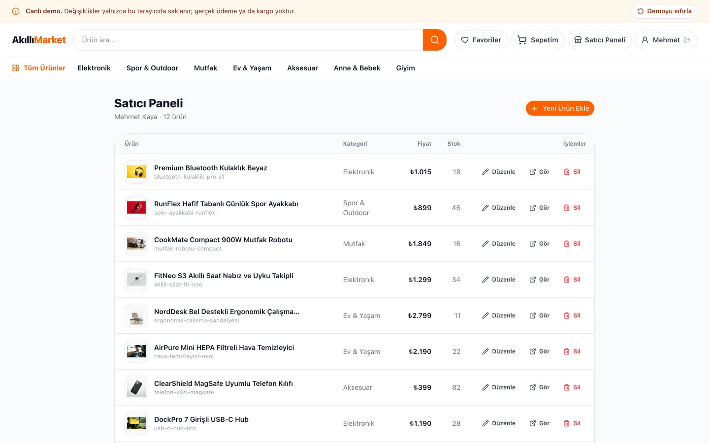</td>
  </tr>
  <tr>
    <td><b>Akıllı Market.</b> ZekAI'ın bağlandığı pazar yeri: ürün sayfası, paket fırsatları, sepet ve sipariş.</td>
    <td><b>Satıcı paneli.</b> Mağazanın ürünleri; ekleme, düzenleme, fiyat ve stok.</td>
  </tr>
  <tr>
    <td>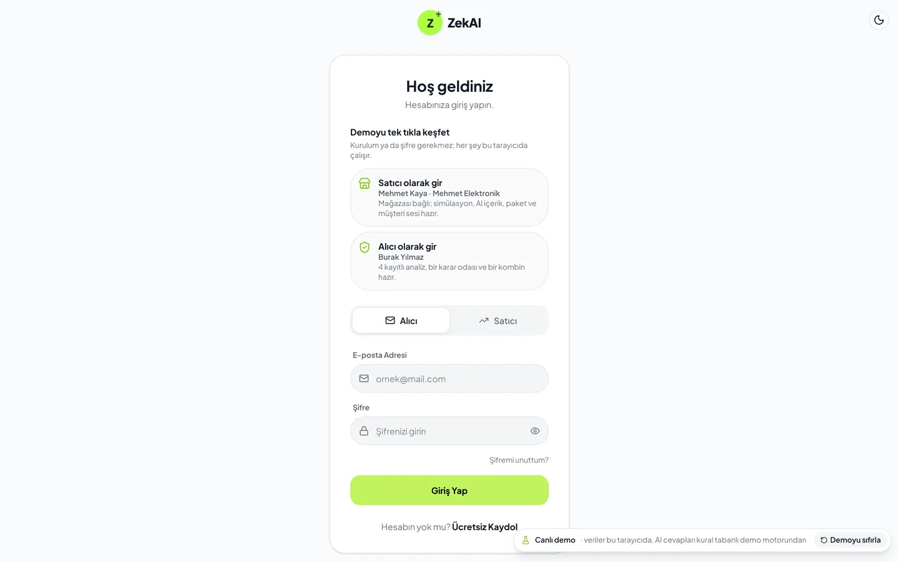</td>
    <td>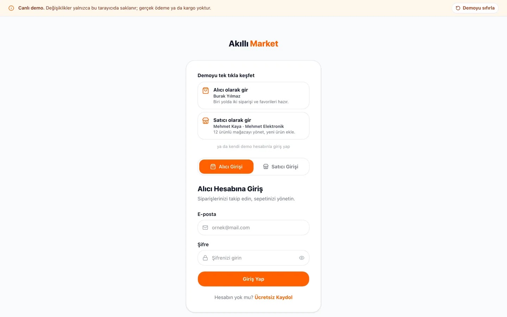</td>
  </tr>
  <tr>
    <td><b>Tek tıkla demo.</b> Her rol için şifresiz bir giriş kartı. Veriler yalnızca senin tarayıcında
    saklanır; <b>Demoyu sıfırla</b> her şeyi başa döndürür.</td>
    <td><b>İki site, dört rol.</b> Akıllı Market'te de alıcı ve satıcı kartları var.</td>
  </tr>
</table>

<p align="center">
  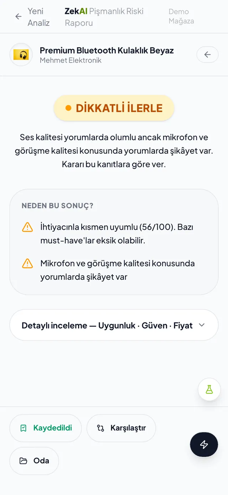&nbsp;
  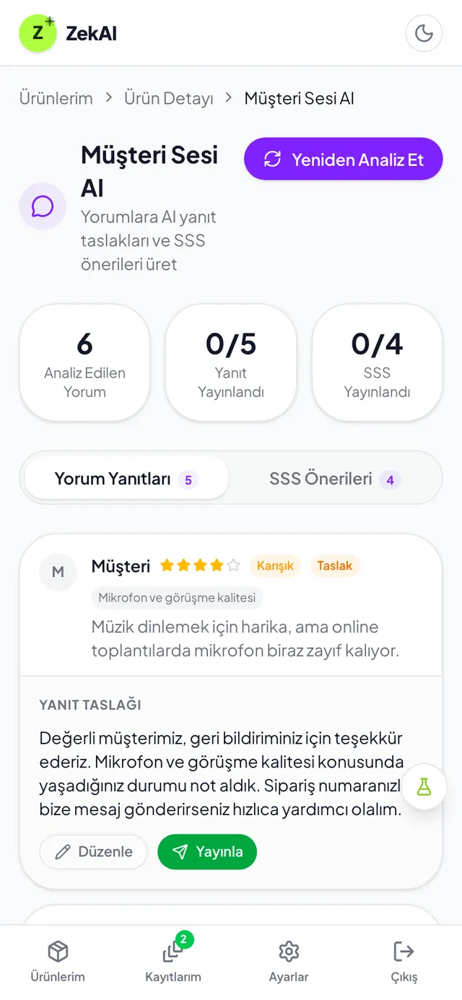&nbsp;
  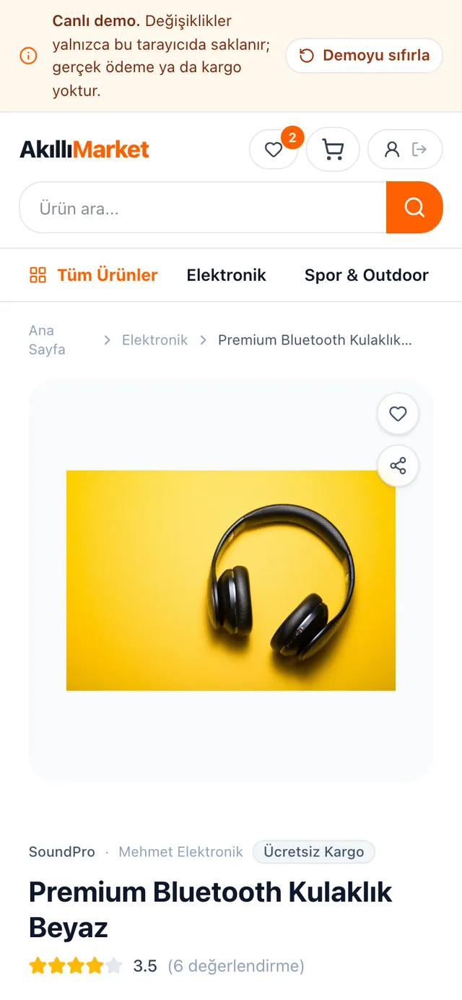
</p>

## Mühendislik tarafında öne çıkanlar

Mülakatlarda en sevdiğim konular; her biri bu repodaki koda dayanıyor:

1. **İki ürün, gerçek bir entegrasyon.** ZekAI pazar yerinin veritabanına değil, API'sine bağlanıyor; satıcı adına
   pazar yerinin verdiği API anahtarıyla. → [Mimari](docs/03-mimari.md)
2. **Aynı başlıkta iki tür kimlik.** `commerce-api`'deki bir policy scheme token'ın biçimine bakıp isteği JWT ya da
   API anahtarı doğrulayıcısına yönlendiriyor; controller'lar farkı bilmiyor. → [Güvenlik](docs/06-guvenlik.md)
3. **Model skor üretir, kararı kod verir.** Gemini dört skor ve kanıtlı uyarılar üretiyor; satın alma kararını açık
   eşiklerle çalışan saf bir fonksiyon veriyor. → [Yapay zekâ hattı](docs/07-yapay-zeka.md)
4. **Yedi çağrıdan bire.** Google ADK ile kurulmuş yedi ajanlı hattı tek bir yapılandırılmış çağrıya ve yalnızca
   gerektiğinde yapılan bir piyasa kontrolüne indirdim; kombin analizi beş çağrıdan bire indi.
5. **Önbellek anahtarı, sonucu değiştiren her şey.** Analiz anahtarı kullanıcıdan, üründen, normalize edilmiş
   ihtiyaçtan ve ürünün parmak izinden türetiliyor; ürün değişince anahtar da değişiyor, ayrı bir temizleme kodu yok.
6. **Kota dolunca dürüst yedek.** Satıcı araçları işaretli bir örnek cevap ve sarı bir uyarı gösteriyor; alıcı
   analizi ise uydurma bir karar yerine açık bir hatayla bitiyor.
7. **Uzun cevap, canlı akış.** AI servisi her adımda bir Server-Sent Event gönderiyor; `zekai-api` akışı satır satır
   aktarırken son raporu yakalayıp önbelleğe yazıyor. → [Arayüz ve tasarım](docs/08-arayuz-ve-tasarim.md)
8. **Kuruşu kuruşuna paket indirimi.** İndirim iki ürüne fiyatlarıyla orantılı paylaştırılıyor; her sipariş satırı
   kendi indirimini taşıyor. → [İş kuralları](docs/05-is-kurallari.md)
9. **Kurallar veritabanında da korunuyor.** Arşivlenmiş paketleri hariç tutan kısmi unique index, alıcı başına tek
   sepet, yoruma tek cevap; para her yerde `numeric`. → [Veritabanı](docs/04-veritabani.md)
10. **Fiyatı sunucu belirler.** Sipariş, fiyatı istemciden değil veritabanından alıyor; ürün puanı her seferinde
    kayıtlı yorumlardan hesaplanıyor.
11. **Satıcının değişikliği vitrine anında.** `commerce-api` her değişiklikten sonra Akıllı Market'in yenileme
    ucunu çağırıyor; Next.js yalnızca etkilenen sayfaları yeniden üretiyor.
12. **Tek arayüz, iki dağıtım.** Bütün ağ çağrıları tek bir `transport` fonksiyonundan geçiyor; Vercel'de aynı
    sözleşmeyi tarayıcıda karşılayan bir demo, Docker'da gerçek API'ler. → [Yayın stratejisi](docs/09-yayin-stratejisi.md)

Eksikleri de saklamadım: test yok, bazı servis dosyaları çok büyük ve bazı sırlar düz metin. Tam liste ve yol
haritası: [Sorular ve sınırlar](docs/12-sorular-ve-sinirlar.md).

## Mimari

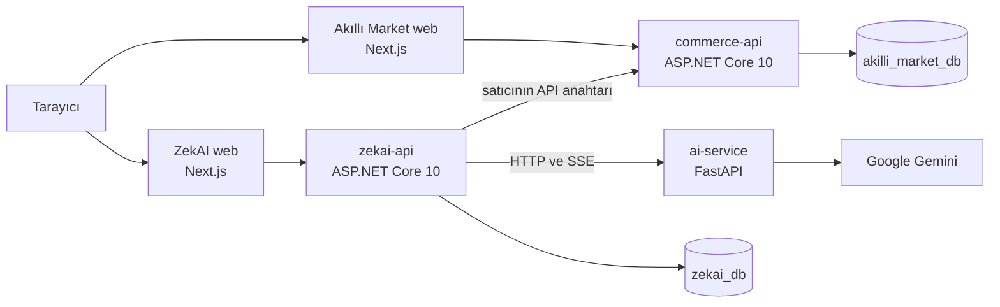

Sistem iki ürün ve üç servisten oluşuyor. Her ürün kendi veritabanının sahibi; ZekAI pazar yerinin verisine yalnızca
API'si üzerinden erişiyor. Tarayıcı yapay zekâ servisini hiç görmüyor; Gemini anahtarı yalnızca o servisin
ortamında duruyor. İki .NET API'si de `Api`, `Application`, `Domain` ve `Infrastructure` projelerine ayrılıyor; AI
servisinde karar ve puanlama kodu modelden ayrı dosyalarda. Ayrıntı: [docs/03-mimari.md](docs/03-mimari.md).

## Teknolojiler

| Katman | Seçimler |
|---|---|
| Arayüzler | Next.js 16 (App Router), React 19, TypeScript (strict), Tailwind CSS 4, shadcn/ui (Radix), Framer Motion |
| Arayüz durumu ve görselleştirme | Zustand 5, TanStack Query 5, React Flow 12, three.js ve React Three Fiber |
| API'ler | .NET 10, ASP.NET Core, Entity Framework Core ve Npgsql, JWT (HS256), BCrypt, Swagger |
| Yapay zekâ | Python 3.12, FastAPI, Google GenAI SDK, Google ADK, Pydantic; `gemini-2.5-flash-lite` varsayılan model |
| Veri | PostgreSQL 16 (`pgvector/pgvector:pg16` imajı), iki ayrı veritabanı |
| Çalıştırma | Docker Compose (veritabanı, iki API ve AI servisi), Vercel (arayüzler ve canlı demo) |

## Tek komutla çalıştır

Backend için Docker yeterli; yapay zekâ özellikleri için bir [Google AI Studio](https://aistudio.google.com)
anahtarı gerekiyor. Anahtar olmadan da sistem açılıyor, yalnızca AI uç noktaları `503` dönüyor.

```bash
git clone https://github.com/mrfiratatalay/btk-zekai.git
cd btk-zekai
cp .env.example .env          # GOOGLE_API_KEY değerini doldur
docker compose up --build     # PostgreSQL, commerce-api, zekai-api, ai-service
```

Arayüzler Docker Compose'un içinde değil; iki ayrı terminalde açılıyor:

```bash
cd apps/akilli-market-web && cp .env.example .env.local && npm install && npm run dev
cd apps/zekai-platform-web && cp .env.example .env.local && npm install && npm run dev -- --port 3001
```

| Adres | Ne var |
|---|---|
| http://localhost:3000 | Akıllı Market |
| http://localhost:3001 | ZekAI |
| http://localhost:5001/swagger, http://localhost:5002/swagger | İki API'nin Swagger arayüzü |

Hesaplar, ortam değişkenleri ve örnek isteklerle API: [docs/10-calistirma-ve-api.md](docs/10-calistirma-ve-api.md).
Windows'ta [`scripts/`](scripts) klasöründeki betikler aynı işi yapıyor.

## Dokümanlar

Projeyi kendi anlatımımla, ayrıntısıyla [`docs/`](docs/README.md) klasöründe açıkladım:

| | |
|---|---|
| [01 · Hikâye](docs/01-hikaye.md) | HackAthon'26 haftası, ekip ve roller, yarışmadan sonra ne yaptım |
| [02 · Demo turu](docs/02-demo-turu.md) | Teknik bilgi gerektirmeyen 5 dakikalık tur |
| [03 · Mimari](docs/03-mimari.md) | İki ürün, üç servis, katmanlar ve bir isteğin yolculuğu |
| [04 · Veritabanı](docs/04-veritabani.md) | İki ayrı veritabanı, şema, veritabanında korunan kurallar |
| [05 · İş kuralları](docs/05-is-kurallari.md) | Paket indirimi, karar motoru, fiyat adaleti, iade riski, kombin |
| [06 · Güvenlik](docs/06-guvenlik.md) | İki ayrı JWT, satıcı API anahtarı, hata biçimi, bilinen eksikler |
| [07 · Yapay zekâ hattı](docs/07-yapay-zeka.md) | Gemini'yi maliyet kontrollü kullanmak: tek çağrı, deterministik karar, önbellek |
| [08 · Arayüz ve tasarım](docs/08-arayuz-ve-tasarim.md) | İki Next.js uygulaması, SSE okuma, tasarım dili, mobil |
| [09 · Yayın stratejisi](docs/09-yayin-stratejisi.md) | Sunucu masrafı olmadan her zaman açık canlı demo |
| [10 · Çalıştırma ve API](docs/10-calistirma-ve-api.md) | Kurulum, ortam değişkenleri, örnek isteklerle API |
| [11 · Çözdüğüm problemler](docs/11-cozdugum-problemler.md) | Problem, çözüm, gerekçe: on iki kısa hikâye |
| [12 · Sorular ve sınırlar](docs/12-sorular-ve-sinirlar.md) | Olası mülakat soruları, bilinen sınırlar, yol haritası |

## Proje yapısı

```text
apps/akilli-market-web/   Pazar yeri arayüzü (Next.js) ve tarayıcı içi demo katmanı
apps/zekai-platform-web/  ZekAI arayüzü: alıcı karar merkezi ve Seller Studio (Next.js), demo katmanı
services/commerce-api/    Pazar yeri API'si (ASP.NET Core): Api / Application / Domain / Infrastructure
services/zekai-api/       ZekAI API'si (ASP.NET Core): mağaza entegrasyonu, AI vekili, önbellek
services/ai-service/      Gemini ile çalışan yapay zekâ servisi (FastAPI): buyer/ ve seller/
infra/postgres/           İki veritabanını açan init.sql
scripts/                  Windows için başlatma betikleri
docs/                     Ayrıntılı dokümanlar ve ekran görüntüleri
docker-compose.yml        PostgreSQL, iki API ve yapay zekâ servisi
```

## Ekip

ZekAI'ı HackAthon'26'da iki kişilik bir takım olarak geliştirdik:

- **Fırat Atalay** · takım kaptanı · [GitHub](https://github.com/mrfiratatalay)
- **Ayşe Mandıralı** · takım arkadaşı

Kimin neyi yazdığı [Hikâye](docs/01-hikaye.md#kim-ne-yaptı) sayfasında. Kodun önemli bir kısmını yapay zekâyla
(Claude Code) birlikte, kendi koyduğum kurallar altında yazdım.

HackAthon'26 için BTK Akademi, Google ve Girişimcilik Vakfı'na teşekkür ederiz. Bu bağımsız bir portfolyo
projesidir. Akıllı Market kurgusal bir pazar yeridir; Google, Gemini, Trendyol, Hepsiburada ve N11 adları
sahiplerine aittir ve yalnızca atıf için anılmıştır. Örnek ürün fotoğrafları Unsplash'tan alınmıştır.
