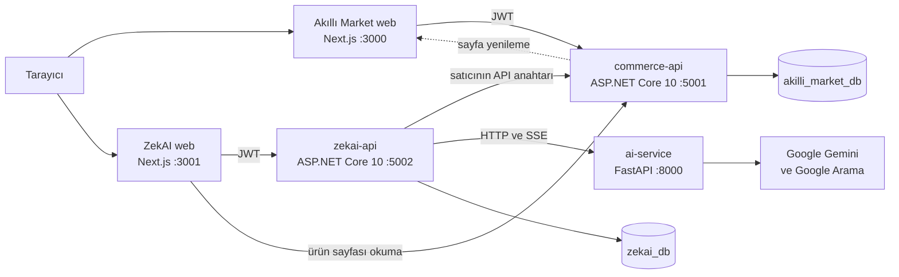
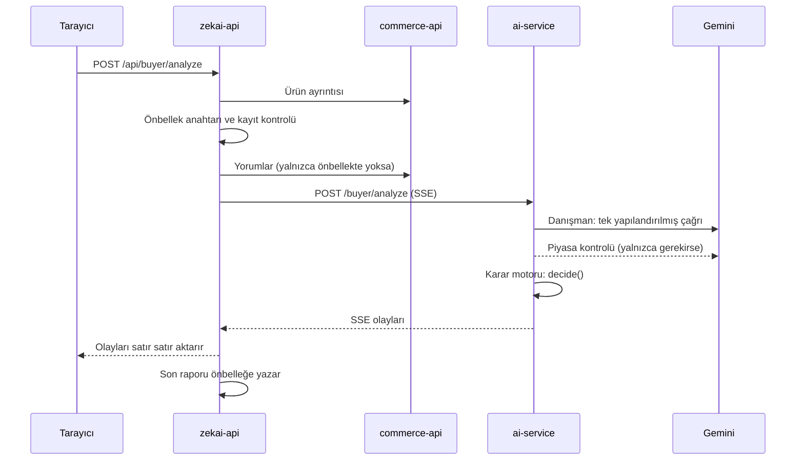

# Mimari

## Büyük resim

Sistem iki ürün ve üç servisten oluşuyor:

| Parça | Teknoloji | Görevi |
|---|---|---|
| `apps/akilli-market-web` | Next.js 16, React 19 | Pazar yeri vitrini, sepet, sipariş, satıcı paneli; 11 sayfa |
| `apps/zekai-platform-web` | Next.js 16, React 19 | ZekAI: alıcı karar merkezi ve Seller Studio; 23 sayfa |
| `services/commerce-api` | ASP.NET Core 10, EF Core, PostgreSQL | Pazar yerinin API'si; 55 uç nokta, 19 tablo |
| `services/zekai-api` | ASP.NET Core 10, EF Core, PostgreSQL | ZekAI'ın API'si, mağaza entegrasyonu ve AI vekili; 71 uç nokta, 14 tablo |
| `services/ai-service` | Python 3.12, FastAPI, Google GenAI SDK | Gemini ile çalışan 12 AI uç noktası |

## Neden iki ayrı ürün?

**Problem.** ZekAI bir satıcının ürünlerini okuyup değiştirebilmeli ve alıcının yapıştırdığı ürün linkini
tanımalı. Bunun için gerçek bir mağaza gerekiyordu. İlk prototipte mağaza, ZekAI'ın içinde sahte bir veri
katmanıydı.

**Çözüm.** 16 Mayıs'ta mağazayı bağımsız bir ürüne ayırdım: **Akıllı Market**, kendi veritabanı, kendi
kullanıcıları ve kendi JWT'siyle ayrı bir sistem. ZekAI ona dışarıdan bağlanıyor: satıcı, pazar yerinin satıcı
panelindeki API anahtarını ZekAI'a giriyor; `zekai-api` sonraki bütün isteklerde bu anahtarı kullanıyor.

**Neden.** Gerçek dünyada bir satıcı aracı da pazar yerine böyle bağlanır; pazar yerinin veritabanına değil,
API'sine erişir. Bu ayrım ZekAI'ın gelecekte başka bir pazar yerine bağlanabilmesini mimaride görünür kılıyor;
mağaza bağlama ekranında Trendyol, Hepsiburada ve N11 seçenekleri "Yakında" olarak duruyor.

**Bedeli.** İki kimlik sistemi, iki veritabanı ve servisler arası HTTP çağrıları. Bir hackathon haftası için
fazladan iş ve fazladan hata noktası demekti. Servisler arası çağrılarda dağıtık transaction yok; tutarlılık API
çağrılarının sırasına dayanıyor.

## Katmanlar

İki .NET API'si de aynı dört projeye ayrılıyor:

| Proje | İçinde ne var |
|---|---|
| `ZekAI.Api` | Controller'lar, kimlik doğrulama ayarı, başlangıçta migration ve seed |
| `ZekAI.Application` | İstek ve cevap DTO'ları |
| `ZekAI.Domain` | Entity'ler ve enum'lar |
| `ZekAI.Infrastructure` | EF Core `DbContext`, migration'lar, servisler ve diğer servislere giden HTTP istemcileri |

Dürüst olmak gerekirse iş mantığı çoğunlukla `Infrastructure` altındaki servis sınıflarında. Örneğin
[`zekai-api` SellerService](../services/zekai-api/src/ZekAI.Infrastructure/Services/SellerService.cs) 1.401 satır;
hackathon hızında büyüdü. Bunu bölmek [yol haritamda](12-sorular-ve-sinirlar.md#yol-haritası).

AI servisi alana göre bölünmüş: [`seller/`](../services/ai-service/seller) altında yedi, [`buyer/`](../services/ai-service/buyer)
altında üç router; deterministik karar ve puanlama kodu [`decision_engine.py`](../services/ai-service/buyer/decision_engine.py)
ve [`scoring_engine.py`](../services/ai-service/buyer/scoring_engine.py) içinde, modelden ayrı duruyor.

## Bir isteğin yolculuğu: ürün analizi

1. Tarayıcı yalnızca `zekai-api` ile konuşuyor; AI servisinin adresi ve Gemini anahtarı tarayıcıya hiç gitmiyor.
2. `zekai-api` ürünü `commerce-api`'den alıyor ve bir önbellek anahtarı hesaplıyor (kullanıcı, ürün, normalize
   edilmiş ihtiyaç ve ürünün parmak izi). Aynı analiz yedi gün içinde istenirse Gemini'ye hiç gidilmiyor.
3. AI servisi önce tek bir yapılandırılmış Gemini çağrısıyla dört skor ve kanıtlı uyarılar üretiyor; danışman
   "piyasa kontrolü gerekli" derse Google Arama ile ikinci bir çağrı yapıyor. Son kararı kod veriyor.
4. Cevap [Server-Sent Events](07-yapay-zeka.md#canlı-akış-sse) ile parça parça akıyor;
   [`BuyerController`](../services/zekai-api/src/ZekAI.Api/Controllers/BuyerController.cs) akışı satır satır
   tarayıcıya aktarıyor ve aradan son raporu yakalayıp önbelleğe yazıyor.

## Bir isteğin yolculuğu: satıcının yayını

1. Satıcı **İçerik Düzenle** ekranında içerik üretiyor: `zekai-api` → `ai-service` → Gemini. Sonuç, girdisinin
   SHA-256 özetiyle birlikte taslak olarak `zekai_db`'ye yazılıyor.
2. **Yayınla** dediğinde `zekai-api`, satıcının API anahtarıyla `commerce-api`'deki ürünü güncelliyor.
3. `commerce-api`, değişiklikten sonra Akıllı Market'in `/api/revalidate` ucunu çağırıyor; Next.js ürün sayfasını
   yeniden üretiyor. Alıcı, satıcının yeni başlığını sayfayı yenilediği anda görüyor.

## Çalışma zamanı

| Ortam | Ne çalışıyor |
|---|---|
| Docker Compose | PostgreSQL (`pgvector/pgvector:pg16`), `commerce-api`, `zekai-api`, `ai-service`; iki veritabanını [`init.sql`](../infra/postgres/init.sql) açıyor |
| Yerel arayüzler | İki Next.js uygulaması `npm run dev` ile; Windows için [`scripts/start-frontends.bat`](../scripts/start-frontends.bat) |
| Yarışma yayını | Arayüzler Vercel'de, üç servis ve veritabanı Render'da (Frankfurt) |
| Bugünkü canlı demo | Arayüzler Vercel'de; backend yerine tarayıcıda çalışan demo katmanı |

API'ler açılışta migration'ları kendisi uyguluyor ve boş veritabanına örnek veriyi yazıyor:
[`DataSeeder`](../services/commerce-api/src/ZekAI.Infrastructure/Seeders/DataSeeder.cs) 48 ürün, 204 yorum, 8 mağaza
ve 2 paket ekliyor; `zekai-api` iki demo hesabı açıyor.

## Tarayıcı içi demo katmanı

İki arayüzde de bütün ağ çağrıları tek bir fonksiyondan geçiyor:
[`transport.ts`](../apps/zekai-platform-web/src/lib/api/transport.ts). `NEXT_PUBLIC_DATA_MODE=api` ile derlenen
sürüm gerçek API'lere gidiyor; diğer derlemeler isteği tarayıcıdaki demo katmanına veriyor ve aynı biçimde bir
`Response` alıyor. Ayrıntısı: [Yayın stratejisi](09-yayin-stratejisi.md).
