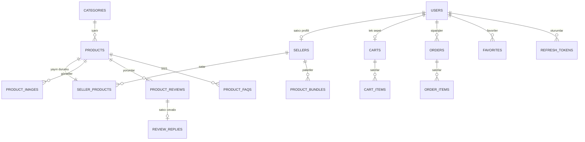

# Veritabanı

## İki ayrı veritabanı

Docker'da tek bir PostgreSQL sunucusu çalışıyor ama içinde iki ayrı veritabanı var;
[`init.sql`](../infra/postgres/init.sql) ikisini de ilk açılışta oluşturuyor.

| Veritabanı | Sahibi | Tablo | Migration |
|---|---|---|---|
| `akilli_market_db` | `commerce-api` | 19 | 10 |
| `zekai_db` | `zekai-api` | 14 | 11 |

**Neden ayrı?** İki ayrı ürünümüz var ve her ürün yalnızca kendi verisinin sahibi. ZekAI, pazar yerinin
veritabanına hiçbir zaman doğrudan bağlanmıyor; ürünü, yorumu ya da stoğu `commerce-api` üzerinden okuyor.
Böylece Akıllı Market'in şeması değişse bile ZekAI'ın görebildiği tek şey API sözleşmesi oluyor.

**Bedeli.** İki veritabanı arasında join ya da ortak transaction yok. ZekAI bir taslağı yayınladığında önce kendi
kaydını yazıyor, sonra pazar yerine HTTP isteği atıyor; ikinci adım başarısız olursa iki taraf bir süre farklı
durabilir.

## Akıllı Market şeması (`akilli_market_db`)

Diyagrama sığmayan üç tablo `ProductPriceHistories` (fiyat ve piyasa medyanı geçmişi), `SocialMediaContents` ve
`StoreConnections`; paketlerin iki ürüne bağlandığı ilişkiler de sadelik için çizilmedi. Tam model:
[`AppDbContext`](../services/commerce-api/src/ZekAI.Infrastructure/Data/AppDbContext.cs).

## ZekAI şeması (`zekai_db`)

| Grup | Tablolar | Ne tutuyor |
|---|---|---|
| Kimlik | `Users`, `RefreshTokens` | ZekAI hesapları ve yenileme token'ları |
| Entegrasyon | `StoreConnections` | Satıcının bağlı pazar yeri ve API anahtarı |
| Alıcı | `Analyses`, `ShoppingProjects`, `ShoppingProjectAnalyses`, `SavedKombins` | Kayıtlı analizler, karar odaları, kombinler |
| AI önbelleği | `AnalysisCaches`, `BundleRecommendationCaches` | Tamamlanmış analiz ve paket önerileri |
| Satıcı çıktıları | `SellerProductDrafts`, `SellerSocialDrafts`, `SellerAiArtifacts`, `ReviewReplyDrafts`, `FaqDrafts` | AI'ın ürettiği ve satıcının düzenlediği taslaklar |

Tam model: [`ZekaiDbContext`](../services/zekai-api/src/ZekAI.Infrastructure/Data/ZekaiDbContext.cs).

## Önemli kararlar

### 1. Ürün kimliği okunur bir slug

`Products.Id` bir GUID değil, `bluetooth-kulaklik-pro-x1` gibi bir metin. Ürün sayfasının adresi doğrudan bu
kimlik. Alıcı ZekAI'a bir link yapıştırdığında, linkin son parçası ürünü bulmaya yetiyor; arama ya da eşleme
gerekmiyor. **Bedeli:** başlık değişse de slug aynı kalıyor; aynı başlıkla ikinci ürün eklenirse slug'a rastgele
altı karakter ekleniyor. Kod: [`GenerateSlug`](../services/commerce-api/src/ZekAI.Infrastructure/Services/SellerService.cs).

### 2. Para her yerde `numeric`, hiç `float` değil

Fiyatlar, sipariş toplamları ve indirimler `numeric(10,2)`, C# tarafında `decimal`. Kayan noktalı sayılar
kuruşları yuvarlarken kaybeder; paket indirimi gibi bölüştürülen tutarlarda bu fark görünür olurdu.

### 3. Kurallar veritabanında da korunuyor

| Kural | Nasıl |
|---|---|
| Bir e-postayla tek hesap | `Users.Email` üzerinde unique index (iki veritabanında da) |
| Alıcı başına tek sepet | `Carts.BuyerId` unique |
| Bir ürün bir kez favori | `(UserId, ProductId)` unique |
| Bir yoruma tek satıcı cevabı | `ReviewReplies.ReviewId` unique |
| Bir ürün çiftine tek **aktif** paket | `(SellerId, PrimaryProductId, ComplementaryProductId)` unique, **yalnızca `Status <> 2`** |
| Bir satıcı bir ürünü bir kez listeler | `(SellerId, ProductId)` unique |
| Sipariş numarası tekil | `Orders.OrderNumber` unique |

Paket indeksindeki filtre bilinçli: arşivlenmiş paketler (`Status = 2`) kısıtın dışında. Satıcı bir paketi
arşivleyip aynı ürün çiftiyle yenisini kurabiliyor, eski paketin geçmişi de silinmeden duruyor.

### 4. AI çıktıları JSON metin olarak, girdinin özetiyle birlikte

AI çıktılarının biçimi sık değişiyordu; her değişiklikte migration yazmak yerine sonucu `ResultJson`,
`PayloadJson` gibi metin kolonlarında tutuyorum. Yanına girdinin SHA-256 özetini (`InputHash`, `CacheKey`)
yazıyorum ve sorguyu bu özete göre index'liyorum. Aynı girdi tekrar geldiğinde kayıt bulunup yeniden
kullanılıyor. Ayrıntı: [Yapay zekâ hattı](07-yapay-zeka.md#önbellek-aynı-soruya-iki-kez-para-ödememek).
**Bedeli:** veritabanı JSON'un içini doğrulamıyor; bozuk bir kayıt ancak okunurken fark ediliyor.

### 5. Silmek yerine arşivlemek

Taslaklar ve AI çıktıları silinmiyor; `Status` alanı `ready` ya da `archived` oluyor. Satıcı yanlışlıkla
arşivlediği bir taslağı geri yükleyebiliyor ve parası ödenmiş bir AI çıktısı kaybolmuyor.

### 6. Arayüzün ürettiği kimlikler

Kayıtlı analizler, karar odaları ve kombinler arayüzde `ExternalId` ile oluşuyor; tabloda `(UserId,
ExternalId)` unique. Aynı analiz iki kez kaydedilmek istenirse yeni satır açılmıyor, mevcut satır güncelleniyor.

## Migration'lar ve örnek veri

- API'ler açılışta `Migrate` ile bekleyen migration'ları uyguluyor; ayrı bir adım gerekmiyor.
- Akıllı Market'in örnek verisi [`DataSeeder`](../services/commerce-api/src/ZekAI.Infrastructure/Seeders/DataSeeder.cs)
  içinde: 7 kategori, 8 mağaza, 48 ürün, 204 yorum ve 2 paket. Seeder eksik kayıtları anahtara göre ekliyor;
  dolu bir veritabanında tekrar çalışınca kopya üretmiyor.
- Ürünlerin fiyat geçmişi formülle üretiliyor: son 30 günde beş nokta, fiyat %90'dan bugüne doğru artıyor,
  piyasa medyanı fiyatın %95'i. Bu veri gerçek bir piyasa ölçümü değil, demo için üretilmiş bir seri.

## Bilinen eksikler

- `commerce-api` açılışında `PendingModelChangesWarning` uyarısı kapatılmış. Model ile migration'lar arasında
  bir fark kalırsa bunu açılışta fark etmiyoruz.
- Docker imajı pgvector içeriyor ve `init.sql` uzantıyı kuruyor, ama hiçbir tablo vektör kolonu kullanmıyor.
- Ürün özellikleri, rozetler ve etiketler `jsonb` değil düz metin (`FeaturesJson`, `TagsJson`) kolonlarında.
- Stok düşümü için iyimser eşzamanlılık kontrolü yok; ayrıntısı [Güvenlik](06-guvenlik.md#bilinen-eksikler)
  sayfasında.
