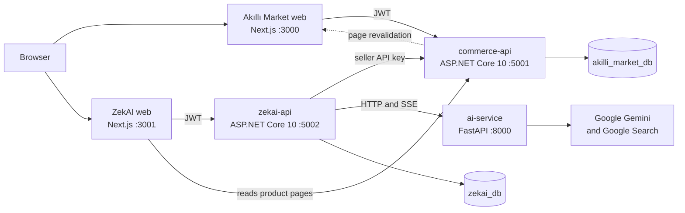
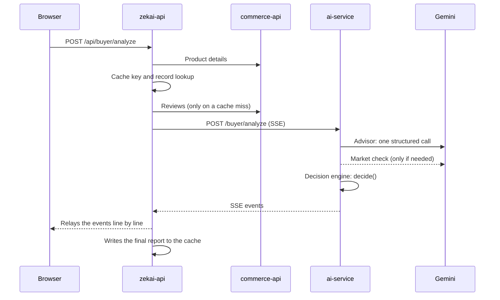

# Architecture

## The big picture

The system is made of two products and three services:

| Part | Technology | Job |
|---|---|---|
| `apps/akilli-market-web` | Next.js 16, React 19 | The marketplace storefront, cart, orders and seller panel; 11 pages |
| `apps/zekai-platform-web` | Next.js 16, React 19 | ZekAI: the buyer decision centre and Seller Studio; 23 pages |
| `services/commerce-api` | ASP.NET Core 10, EF Core, PostgreSQL | The marketplace API; 55 endpoints, 19 tables |
| `services/zekai-api` | ASP.NET Core 10, EF Core, PostgreSQL | ZekAI's API, the store integration and the AI proxy; 71 endpoints, 14 tables |
| `services/ai-service` | Python 3.12, FastAPI, Google GenAI SDK | 12 AI endpoints running on Gemini |

## Why two separate products?

**Problem.** ZekAI has to read and change a seller's products and recognise a product link pasted by a buyer.
That needed a real store. In the first prototype, the store was a fake data layer inside ZekAI.

**Solution.** On 16 May I split the store into an independent product: **Akıllı Market**, a separate system with
its own database, its own users and its own JWT. ZekAI connects to it from the outside: the seller enters the API
key from the marketplace's seller panel into ZekAI, and `zekai-api` uses that key for every later request.

**Why.** A real seller tool connects to a marketplace the same way: it reaches the marketplace's API, not its
database. The split also makes it visible in the architecture that ZekAI could connect to another marketplace
later; the store connection screen lists Trendyol, Hepsiburada and N11 as "Yakında" (coming soon).

**Cost.** Two identity systems, two databases and HTTP calls between services. For a hackathon week that meant
extra work and extra points of failure. There are no distributed transactions between the services; consistency
relies on the order of the API calls.

## Layers

Both .NET APIs are split into the same four projects:

| Project | What's inside |
|---|---|
| `ZekAI.Api` | Controllers, authentication setup, migrations and seeding at startup |
| `ZekAI.Application` | Request and response DTOs |
| `ZekAI.Domain` | Entities and enums |
| `ZekAI.Infrastructure` | The EF Core `DbContext`, migrations, services and HTTP clients for the other services |

To be honest, most of the business logic lives in the service classes under `Infrastructure`. For example,
[`zekai-api` SellerService](../../services/zekai-api/src/ZekAI.Infrastructure/Services/SellerService.cs) is
1,401 lines; it grew at hackathon speed. Splitting it is on my [roadmap](12-faq-and-limits.md#roadmap).

The AI service is split by domain: seven routers under [`seller/`](../../services/ai-service/seller) and three
under [`buyer/`](../../services/ai-service/buyer). The deterministic decision and scoring code lives in
[`decision_engine.py`](../../services/ai-service/buyer/decision_engine.py) and
[`scoring_engine.py`](../../services/ai-service/buyer/scoring_engine.py), apart from the model.

## The journey of a request: product analysis

1. The browser only talks to `zekai-api`; the AI service's address and the Gemini key never reach the browser.
2. `zekai-api` fetches the product from `commerce-api` and computes a cache key (user, product, normalised need
   and the product's fingerprint). If the same analysis is requested again within seven days, Gemini is not
   called at all.
3. The AI service first makes a single structured Gemini call that returns four scores and evidence-backed
   warnings. If the advisor says "a market check is needed", it makes a second call with Google Search. The final
   verdict comes from code.
4. The answer streams back piece by piece as [Server-Sent Events](07-ai-pipeline.md#live-streaming-sse);
   [`BuyerController`](../../services/zekai-api/src/ZekAI.Api/Controllers/BuyerController.cs) relays the stream
   to the browser line by line, catching the final report on the way and writing it to the cache.

## The journey of a request: a seller publishes

1. On the **İçerik Düzenle** (edit content) screen the seller generates content: `zekai-api` → `ai-service` →
   Gemini. The result is saved as a draft in `zekai_db`, together with the SHA-256 hash of its input.
2. When the seller clicks **Yayınla** (publish), `zekai-api` updates the product in `commerce-api` with the
   seller's API key.
3. After the change, `commerce-api` calls Akıllı Market's `/api/revalidate` endpoint and Next.js regenerates the
   product page. A buyer sees the seller's new title as soon as they refresh the page.

## Runtime

| Environment | What runs |
|---|---|
| Docker Compose | PostgreSQL (`pgvector/pgvector:pg16`), `commerce-api`, `zekai-api`, `ai-service`; [`init.sql`](../../infra/postgres/init.sql) creates both databases |
| Local frontends | The two Next.js apps with `npm run dev`; on Windows, [`scripts/start-frontends.bat`](../../scripts/start-frontends.bat) |
| Competition deployment | Frontends on Vercel; the three services and the database on Render (Frankfurt) |
| Today's live demo | Frontends on Vercel; an in-browser demo layer instead of a backend |

The APIs apply their own migrations at startup and write sample data into an empty database:
[`DataSeeder`](../../services/commerce-api/src/ZekAI.Infrastructure/Seeders/DataSeeder.cs) adds 48 products, 204
reviews, 8 stores and 2 bundles; `zekai-api` creates two demo accounts.

## The in-browser demo layer

In both frontends, every network call goes through a single function:
[`transport.ts`](../../apps/zekai-platform-web/src/lib/api/transport.ts). A build with `NEXT_PUBLIC_DATA_MODE=api`
goes to the real APIs; every other build hands the request to the demo layer in the browser and gets back a
`Response` of the same shape. Details: [Deployment strategy](09-deployment-strategy.md).
