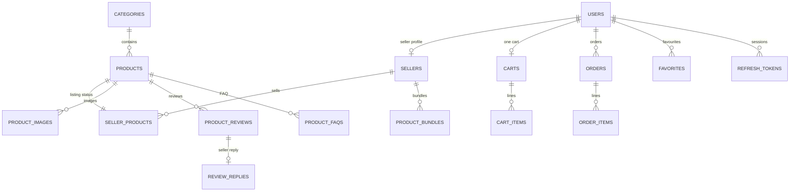

# Database

## Two separate databases

A single PostgreSQL server runs in Docker, but it holds two separate databases;
[`init.sql`](../../infra/postgres/init.sql) creates both on first start.

| Database | Owner | Tables | Migrations |
|---|---|---|---|
| `akilli_market_db` | `commerce-api` | 19 | 10 |
| `zekai_db` | `zekai-api` | 14 | 11 |

**Why separate?** We have two separate products, and each one owns only its own data. ZekAI never connects to the
marketplace's database directly; it reads products, reviews and stock through `commerce-api`. So even if Akıllı
Market's schema changes, all ZekAI can see is the API contract.

**Cost.** There are no joins and no shared transactions across the two databases. When ZekAI publishes a draft, it
first writes its own record and then sends an HTTP request to the marketplace; if the second step fails, the two
sides can disagree for a while.

## Akıllı Market schema (`akilli_market_db`)

Three tables did not fit the diagram: `ProductPriceHistories` (price and market median history),
`SocialMediaContents` and `StoreConnections`. For simplicity, the links from a bundle to its two products are not
drawn either. The full model:
[`AppDbContext`](../../services/commerce-api/src/ZekAI.Infrastructure/Data/AppDbContext.cs).

## ZekAI schema (`zekai_db`)

| Group | Tables | What they hold |
|---|---|---|
| Identity | `Users`, `RefreshTokens` | ZekAI accounts and refresh tokens |
| Integration | `StoreConnections` | The seller's connected marketplace and API key |
| Buyer | `Analyses`, `ShoppingProjects`, `ShoppingProjectAnalyses`, `SavedKombins` | Saved analyses, decision rooms, kombins |
| AI cache | `AnalysisCaches`, `BundleRecommendationCaches` | Completed analyses and bundle recommendations |
| Seller outputs | `SellerProductDrafts`, `SellerSocialDrafts`, `SellerAiArtifacts`, `ReviewReplyDrafts`, `FaqDrafts` | Drafts produced by AI and edited by the seller |

The full model: [`ZekaiDbContext`](../../services/zekai-api/src/ZekAI.Infrastructure/Data/ZekaiDbContext.cs).

## Key decisions

### 1. The product ID is a readable slug

`Products.Id` is not a GUID but text such as `bluetooth-kulaklik-pro-x1`. The product page's address is this ID.
When a buyer pastes a link into ZekAI, the last segment of the link is enough to find the product; no search or
mapping is needed. **Cost:** the slug stays the same even if the title changes, and if a second product is added
with the same title, six random characters are appended to its slug. Code:
[`GenerateSlug`](../../services/commerce-api/src/ZekAI.Infrastructure/Services/SellerService.cs).

### 2. Money is `numeric` everywhere, never `float`

Prices, order totals and discounts are `numeric(10,2)` in the database and `decimal` in C#. Floating-point numbers
lose cents when rounding, and with amounts that are split, such as a bundle discount, the difference would show.

### 3. Rules are enforced in the database too

| Rule | How |
|---|---|
| One account per email | A unique index on `Users.Email` (in both databases) |
| One cart per buyer | `Carts.BuyerId` unique |
| A product can be a favourite only once | `(UserId, ProductId)` unique |
| One seller reply per review | `ReviewReplies.ReviewId` unique |
| One **active** bundle per product pair | `(SellerId, PrimaryProductId, ComplementaryProductId)` unique, **only where `Status <> 2`** |
| A seller lists a product only once | `(SellerId, ProductId)` unique |
| Unique order numbers | `Orders.OrderNumber` unique |

The filter on the bundle index is deliberate: archived bundles (`Status = 2`) are outside the constraint. A seller
can archive a bundle and create a new one for the same product pair, and the old bundle's history stays.

### 4. AI outputs as JSON text, stored with a hash of their input

The shape of the AI outputs changed often. Instead of writing a migration every time, I keep the result in text
columns such as `ResultJson` and `PayloadJson`. Next to it I store the SHA-256 hash of the input (`InputHash`,
`CacheKey`) and index lookups on that hash. When the same input comes again, the record is found and reused.
Details: [AI pipeline](07-ai-pipeline.md#caching-never-pay-twice-for-the-same-question). **Cost:** the database
does not validate the JSON inside; a broken record is only noticed when it is read.

### 5. Archive instead of delete

Drafts and AI outputs are never deleted; their `Status` becomes `ready` or `archived`. A seller can restore a
draft they archived by mistake, and an AI output that was already paid for is never lost.

### 6. IDs created by the frontend

Saved analyses, decision rooms and kombins are created in the frontend with an `ExternalId`, and the table has a
unique `(UserId, ExternalId)` pair. If the same analysis is saved twice, no new row is created; the existing row is
updated.

## Migrations and seed data

- At startup the APIs apply pending migrations with `Migrate`; no separate step is needed.
- Akıllı Market's sample data lives in
  [`DataSeeder`](../../services/commerce-api/src/ZekAI.Infrastructure/Seeders/DataSeeder.cs): 7 categories, 8
  stores, 48 products, 204 reviews and 2 bundles. The seeder adds missing records by key, so running it again on
  a full database creates no duplicates.
- Product price history is generated by a formula: five points over the last 30 days, the price rising from 90%
  to today's price, and a market median at 95% of the price. This is not a real market measurement; it is a
  series generated for the demo.

## Known gaps

- `commerce-api` suppresses the `PendingModelChangesWarning` warning at startup. If the model and the migrations
  drift apart, we do not notice it at startup.
- The Docker image includes pgvector and `init.sql` installs the extension, but no table uses a vector column.
- Product features, badges and tags are stored in plain text columns (`FeaturesJson`, `TagsJson`), not `jsonb`.
- There is no optimistic concurrency check on stock deduction; see [Security](06-security.md#known-gaps).
